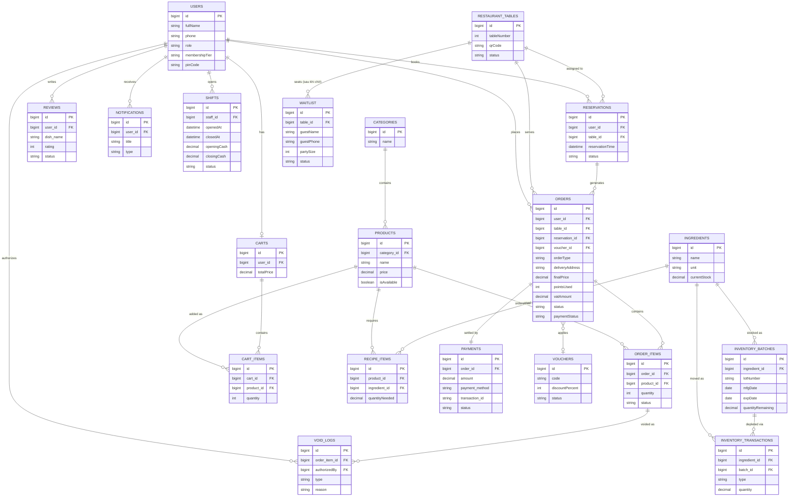

# Thiết kế Database — AppDatMon (HKDN-2026)

Sơ đồ ERD tổng thể, gồm 12 bảng gốc (theo SRS ban đầu) + 3 bảng đã code (Voucher, InventoryTransaction, RecipeItem) + 5 bảng mới đề xuất (Ingredient, InventoryBatch, Waitlist, Shift, VoidLog).

Chi tiết từng cột (kiểu dữ liệu, ý nghĩa, UC liên quan) xem file `Thiet_ke_Database_moi_AppDatMon.xlsx` đi kèm.

## Trạng thái triển khai

- ✅ Đã thiết kế & lên sơ đồ (file này + file Excel)
- ⏳ Chưa code vào repo — các bảng `Users`/`Orders`/`Reviews` cần sửa là file dùng chung cả nhóm, nên đợi xác nhận trước khi đụng vào
- ✅ `Voucher`, `InventoryTransaction`, `RecipeItem` đã có code thật trong `backend/src/models/`
